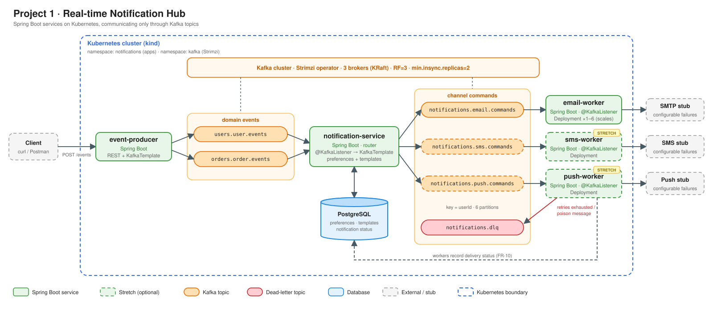

# Project 1 · Notification Hub

> **Publish once, notify many.**

**Level:** Intermediate · **Core effort:** a weekend

## What you build

Services publish events (`UserSignedUp`, `OrderShipped`). A **router** turns each event into email, SMS and push jobs. **Workers** deliver them through stub providers.

**You learn:** Kafka basics (topics, partitions, keys, consumer groups, DLQ) and Kubernetes basics (Deployments, ConfigMaps, probes, Strimzi).

## Event-driven architecture

**Style:** event notification + fan-out

```
event  →  router  →  channel commands  →  workers
```

- **Fire and forget.** Producers don't know who listens.
- **One event, many reactions.** `OrderShipped` becomes an email *and* a push.
- **Kafka is the buffer.** If a worker is down, events wait. Nothing is lost.

> 🧠 **Remember:** *The producer doesn't know the consumer. The consumer doesn't trust delivery.*
> Kafka can deliver a message twice, so every consumer must handle duplicates.

## Architecture



| Service | Job |
|---------|-----|
| `event-producer` | `POST /events` → Kafka (stands in for real services) |
| `notification-service` | Event → which channels → channel commands |
| `email-worker` / `sms-worker` / `push-worker` | Command → stub provider → save status |

| Topic | Key | Holds |
|-------|-----|-------|
| `users.user.events`, `orders.order.events` | `userId` | Domain events |
| `notifications.{email,sms,push}.commands` | `userId` | One job per channel |
| `notifications.dlq` | original key | Messages that failed for good |

## Scope

- **Core:** producer, router, **email-worker only**, retries, DLQ, on kind + Strimzi. Pass AT-1 to AT-4.
- **Stretch:** SMS/push workers, preferences, templates, DLQ replay, status API, metrics.

## Spring Boot building blocks

| Need | Use |
|------|-----|
| Publish | `KafkaTemplate` + `JsonSerializer` |
| Consume | `@KafkaListener` (`concurrency` ≤ partitions) |
| Retry + DLQ | `DefaultErrorHandler` + `ExponentialBackOff` + `DeadLetterPublishingRecoverer` |
| Bad JSON | `ErrorHandlingDeserializer` (sends straight to the DLQ, no retries) |
| No double send | JPA + unique key `(event_id, channel)` |
| Probes | Actuator `/actuator/health/liveness` and `/readiness` |
| Graceful stop | `server.shutdown=graceful` |
| Config | ConfigMap/Secret → env vars (`SPRING_KAFKA_BOOTSTRAP_SERVERS`) |
| Tests | Testcontainers + `@ServiceConnection` |
| Image | `mvn spring-boot:build-image` → `kind load docker-image` |

## Functional requirements

| ID | Scope | Requirement |
|----|-------|-------------|
| **FR-1** | **Core** | **Publish:** `POST /events` puts an event on Kafka. |
| **FR-2** | **Core** | **Route:** map each event type to channels (`OrderShipped` → email + push). |
| **FR-3** | Stretch | **Preferences:** users opt out per channel, and skipped messages are recorded as `SKIPPED_OPT_OUT`. |
| **FR-4** | Stretch | **Templates:** render text from templates (`Hi {{name}}`). |
| **FR-5** | **Core** | **Deliver:** workers call a stub provider with a configurable failure rate. |
| **FR-6** | **Core** | **No double send:** ID = `eventId + channel`. Skip if it's already `SENT`. |
| **FR-7** | **Core** | **Retry:** 3 retries with backoff for temporary errors. |
| **FR-8** | **Core** | **Dead-letter:** failed or malformed messages go to `notifications.dlq` with error headers. |
| **FR-9** | Stretch | **Replay:** re-send DLQ messages to their original topic. |
| **FR-10** | Stretch | **Status:** `GET /notifications?userId=` shows `SENT`, `FAILED` or `SKIPPED`. |
| **FR-11** | **Core** | **Skip unknown:** unknown event types are logged and never block the partition. |

## Non-functional requirements

| ID | Scope | Area | Requirement |
|----|-------|------|-------------|
| **NFR-1** | **Core** | Reliability | **Commit after work:** commit offsets only after processing. |
| **NFR-2** | Stretch | Reliability | **No duplicates to users:** a crash or rebalance never sends twice. |
| **NFR-3** | **Core** | Reliability | **No loss:** `acks=all`, idempotent producer, RF=3, `min.insync.replicas=2`. |
| **NFR-4** | Stretch | Reliability | **Survive a broker:** keeps working with 1 of 3 brokers down. |
| **NFR-5** | **Core** | Reliability | **Per-user order:** key = `userId`. |
| **NFR-6** | Stretch | Reliability | **Isolate bad messages:** a bad message never blocks a partition. |
| **NFR-7** | Stretch | Performance | **500 events/s** sustained. |
| **NFR-8** | Stretch | Performance | **p95 < 2 s** from event to provider. |
| **NFR-9** | **Core** | Scale | **Scale 1 → 6 workers** with no loss or duplicates. |
| **NFR-10** | **Core** | Ops | **Config outside the image:** ConfigMaps for settings, Secrets for keys. |
| **NFR-11** | **Core** | Ops | **Probes:** ready only when Kafka and the DB are connected. |
| **NFR-12** | **Core** | Ops | **Graceful stop:** on `SIGTERM`, finish, commit and exit in under 30 s. |
| **NFR-13** | Stretch | Ops | **Fits a laptop:** requests and limits set, whole stack ≈ 8 GB. |
| **NFR-14** | **Core** | Ops | **One command:** `make up` builds everything. |
| **NFR-15** | Stretch | Observability | **JSON logs** with `eventId`, `userId` and `channel`. |
| **NFR-16** | Stretch | Observability | **Metrics:** sent, failed and DLQ counts, plus consumer lag. |
| **NFR-17** | Stretch | Quality | **Tests on real Kafka** with Testcontainers. |

## Acceptance tests

| # | Scope | Do this | Pass when | Proves |
|---|-------|---------|-----------|--------|
| AT-1 | **Core** | Scale `email-worker` 1 → 3 under load | Partitions spread across 3 pods, no loss or duplicates | NFR-9 |
| AT-2 | **Core** | Kill a worker pod mid-work | Another pod finishes, and each email is sent once | NFR-1, FR-6 |
| AT-3 | **Core** | Set stub failures to 20% | Retries recover most; the rest land in the DLQ | FR-7, FR-8 |
| AT-4 | **Core** | Send bad JSON | It goes straight to the DLQ and the partition keeps moving | FR-8 |
| AT-5 | Stretch | Replay the DLQ at 0% failures | Everything ends up `SENT` | FR-9 |
| AT-6 | Stretch | Kill one Kafka broker | No data loss | NFR-3, NFR-4 |
| AT-7 | Stretch | Opt out of SMS, then reset a password | Email is sent, SMS is skipped | FR-3 |

## Out of scope

Real providers · auth · UI · Schema Registry and autoscaling (they come in Project 2).
