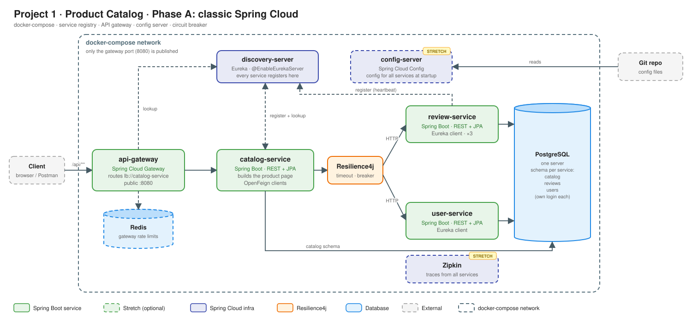
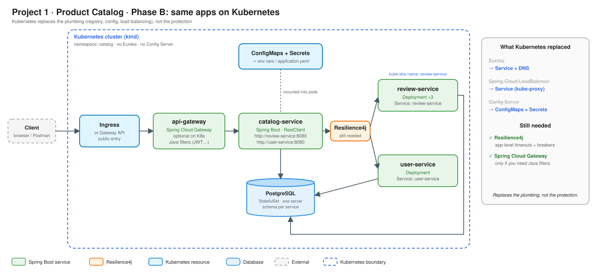
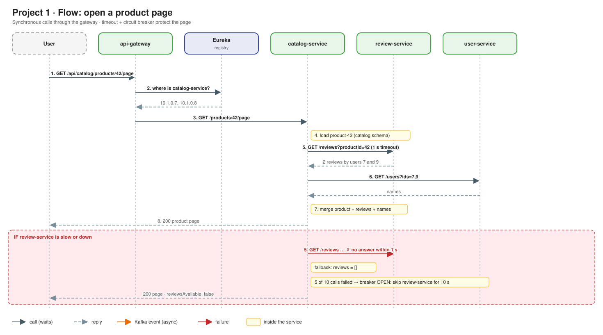

# Project 1 · Product Catalog

> **Find it, route it, protect it.**

**Level:** Beginner → Intermediate · **Core effort:** a weekend · **Next:** Project 2

## What you build

A product page API. `catalog-service` calls `review-service` and `user-service` over **HTTP** and combines the answers into one response. All client traffic enters through an **API gateway**.

You build it twice:
- **Phase A:** classic Spring Cloud on docker-compose (Eureka, Gateway, Config Server)
- **Phase B:** the same apps on Kubernetes, after deleting what Kubernetes replaces

**You learn:** service discovery, API gateway, circuit breakers and timeouts, central config and distributed tracing, plus Kubernetes Services/DNS, Ingress and ConfigMaps.

## Request-driven architecture

**Style:** synchronous request/response microservices

```
client  →  gateway  →  catalog-service  →  review-service
                                       →  user-service
```

- **The caller waits.** Each call blocks until the other service answers.
- **Services must find each other.** Use a registry (Eureka) or Kubernetes DNS. Never hard-code IPs.
- **One slow service can slow everything.** That's a cascading failure, and circuit breakers prevent it.

> 🧠 **Remember:** *Find it (registry). Route it (gateway). Protect it (breaker).*
> And: **a call is a promise to wait, so never wait forever.** Every call needs a timeout.

### Compared with the Kafka projects

| | Project 1: request-driven | Projects 3–5: event-driven |
|---|---|---|
| Talk by | HTTP call, wait for the answer | Publish an event, don't wait |
| Callee is down | Caller fails, unless you add a fallback | Events wait in Kafka |
| Consistency | Immediate | Eventual |
| Best for | Queries, "I need the answer now" | Workflows, fan-out, "something happened" |

## Architecture

### Phase A · classic Spring Cloud (docker-compose)



### Phase B · same apps on Kubernetes



| Phase A (Spring Cloud) | Phase B (Kubernetes) |
|------------------------|----------------------|
| Eureka | ❌ → **Service + DNS** (`http://review-service:8080`) |
| Spring Cloud LoadBalancer | ❌ → **Service** (kube-proxy) |
| Config Server | ❌ → **ConfigMaps + Secrets** |
| Spring Cloud Gateway | ⚠️ Keep it behind an Ingress, or swap for the Gateway API |
| Resilience4j | ✅ **Keep it.** Kubernetes doesn't protect app-to-app calls. |

> 🧠 **Kubernetes replaces the plumbing, not the protection.**

| Service | Job |
|---------|-----|
| `api-gateway` | Single front door: routing, and later auth, rate limits and correlation IDs |
| `catalog-service` | Products CRUD + the product page (calls the two services below) |
| `review-service` | Reviews per product |
| `user-service` | Users (reviewer names) |
| `discovery-server` | Eureka registry (**Phase A only**) |
| `config-server` | Central config from Git (**Phase A only**) |

## Why each piece exists

> 🧠 Every piece must answer: **what breaks without me?**

| Piece | What breaks without it |
|-------|------------------------|
| `api-gateway` | Clients must know every service's address, and every service repeats auth, CORS and rate limiting. |
| Eureka (Phase A only) | Services need hard-coded IPs that break on every restart. On Kubernetes, DNS does this job, so it's deleted in Phase B. |
| Resilience4j | One slow service hangs every page that calls it (cascading failure). |
| 3 services | You can't practise service-to-service calls with one service. **Real world:** start with one app, and split by business capability or team, not by noun. |
| **One Postgres, one schema per service** | Each service owns its tables, so the reviews team can change its schema without breaking the catalog. Separate servers would add cost and ops work with no benefit here. |
| Config Server (stretch) | Only useful without Kubernetes. ConfigMaps replace it. |

## How it works

### User stories

**User side**

| As a… | I want to… | So that… |
|-------|------------|----------|
| Shopper | open one product page | I see the product, its reviews and who wrote them |
| Shopper | still see the product when reviews are broken | one broken part doesn't break the whole page |
| Admin | add and edit products | the catalog stays up to date |
| Reviewer | post a review *(stretch: logged in)* | others can read my opinion |

**Service side**

| Service | Its story |
|---------|-----------|
| `api-gateway` | I'm the only public door. I route `/api/**` to the right service. |
| `discovery-server` | I keep a live list of which service runs where. |
| `catalog-service` | I find other services **by name**, call them with a **1 s timeout**, and use a **fallback** if they fail. |
| `review-service`, `user-service` | I register when I start and answer fast. I know nothing about the page. |

### Flow: open a product page



1. The user calls the gateway: `GET /api/catalog/products/42/page`.
2. The gateway asks Eureka where `catalog-service` is.
3. The gateway forwards the request.
4. Catalog loads product 42 from its own `catalog` schema.
5. Catalog asks `review-service` for reviews (1 s timeout).
6. Catalog asks `user-service` for the reviewers' names.
7. Catalog merges everything.
8. The user gets one page.

**If reviews fail:** the call stops after 1 s and the fallback returns `reviews: []`. After 5 failures in 10 calls the breaker **opens** and skips `review-service` for 10 s. The page still loads.

## Scope

- **Core:** gateway + Eureka + 3 services + timeouts, breaker and fallback on docker-compose, then move to kind **without** Eureka. Pass AT-1 to AT-5.
- **Stretch:** Config Server, JWT auth, rate limiting, retry, bulkhead, Zipkin tracing, canary routing.

## Spring Boot building blocks

| Need | Use |
|------|-----|
| Versions | The **Spring Cloud release train** that matches your Boot version (see the compatibility table at spring.io/projects/spring-cloud) |
| Registry server | `spring-cloud-starter-netflix-eureka-server` + `@EnableEurekaServer` |
| Registry client | `spring-cloud-starter-netflix-eureka-client` |
| Gateway | Spring Cloud Gateway: routes like `uri: lb://catalog-service`, `Path=/api/catalog/**` |
| Service calls | `@FeignClient(name = "review-service")`, or `RestClient` + `@LoadBalanced` |
| Timeouts + breaker | `spring-cloud-starter-circuitbreaker-resilience4j`: `@CircuitBreaker(name = "reviews", fallbackMethod = "noReviews")` |
| Retry / bulkhead | Resilience4j `@Retry`, `@Bulkhead` |
| Central config | `spring-cloud-config-server`; clients use `spring.config.import=configserver:` |
| Rate limit | Gateway `RequestRateLimiter` filter + Redis |
| Auth | `spring-boot-starter-oauth2-resource-server` on the gateway (JWT) |
| Tracing | Micrometer Tracing + Zipkin |
| Phase B switch | `eureka.client.enabled=false`, and call `http://review-service:8080` (Kubernetes DNS) |

## Functional requirements

| ID | Scope | Requirement |
|----|-------|-------------|
| **FR-1** | **Core** | **Products:** CRUD on `/products`. |
| **FR-2** | **Core** | **Reviews:** add and list reviews per product. |
| **FR-3** | **Core** | **Users:** create a user, and get users by a list of IDs (one batch call). |
| **FR-4** | **Core** | **Product page:** `GET /products/{id}/page` = product + reviews + reviewer names. |
| **FR-5** | **Core** | **One front door:** clients only call the gateway (`/api/catalog/**`, `/api/reviews/**`, `/api/users/**`). |
| **FR-6** | **Core** | **Call by name:** services call `review-service`, never an IP or port. |
| **FR-7** | **Core** | **Fallback:** if reviews are down, the page still returns, with `reviews: []` and `reviewsAvailable: false`. |
| **FR-8** | Stretch | **Central config:** settings come from Config Server (Git) and refresh without a rebuild. |
| **FR-9** | Stretch | **Auth:** the gateway checks a JWT. `GET` is public, `POST` is protected. |
| **FR-10** | Stretch | **Rate limit:** max N requests/s per client at the gateway → `429`. |
| **FR-11** | Stretch | **Correlation ID:** the gateway adds `X-Correlation-Id` and every service logs it. |
| **FR-12** | Stretch | **Canary:** send 10% of `/api/catalog/**` traffic to `catalog-service` v2. |

## Non-functional requirements

| ID | Scope | Area | Requirement |
|----|-------|------|-------------|
| **NFR-1** | **Core** | Resilience | **Timeouts everywhere:** every outbound call times out (e.g. 1 s). |
| **NFR-2** | **Core** | Resilience | **Circuit breaker:** opens at 50% failures over 10 calls, and tries again after 10 s. |
| **NFR-3** | Stretch | Resilience | **Retry only safe calls:** retry `GET`s (max 2, with backoff). Never retry a `POST`. |
| **NFR-4** | Stretch | Resilience | **Bulkhead:** cap concurrent calls per dependency, so one slow service can't take every thread. |
| **NFR-5** | **Core** | Discovery | **Self-registration:** new instances appear and dead ones disappear automatically. |
| **NFR-6** | **Core** | Scale | **Load balanced:** with 3 `review-service` instances, calls spread across all of them. |
| **NFR-7** | Stretch | Performance | **p95 < 300 ms** for the product page when everything is healthy. |
| **NFR-8** | Stretch | Performance | **Fail fast:** with the breaker open, the page adds under 50 ms. |
| **NFR-9** | **Core** | Ops | **Phase A in one command:** `docker compose up`. |
| **NFR-10** | **Core** | Ops | **Phase B on kind:** same images, with no Eureka and no Config Server. |
| **NFR-11** | Stretch | Ops | **Config outside the image:** Config Server in Phase A, ConfigMaps in Phase B. |
| **NFR-12** | **Core** | Ops | **Health:** Actuator on every service, used as probes in Phase B. |
| **NFR-13** | Stretch | Observability | **One trace per request** across gateway → catalog → reviews/users. |
| **NFR-14** | Stretch | Observability | **Breaker metrics:** state and failure rate via Actuator/Prometheus. |
| **NFR-15** | Stretch | Security | **Only the gateway is public.** Services stay internal (compose network / `ClusterIP`). |

## Acceptance tests

| # | Scope | Do this | Pass when | Proves |
|---|-------|---------|-----------|--------|
| AT-1 | **Core** | Restart `review-service` on a new port or IP | Calls still work, with no config change | FR-6, NFR-5 |
| AT-2 | **Core** | 😱 **Feel the pain:** breaker off, add a 3 s delay to reviews, run a load test | The catalog slows down and fails too: a **cascading failure** | why NFR-1 and NFR-2 exist |
| AT-3 | **Core** | 🛡️ **Fix it:** turn the timeout and breaker on, repeat AT-2 | The page stays fast with `reviews: []`, the breaker shows `OPEN`, and it closes after recovery | FR-7, NFR-1, NFR-2 |
| AT-4 | **Core** | Scale `review-service` to 3 | Requests spread across all 3 (check the instance ID in logs) | NFR-6 |
| AT-5 | **Core** | Move to kind and delete Eureka | AT-1, AT-3 and AT-4 still pass | NFR-10 |
| AT-6 | Stretch | Send 100 req/s from one client | The gateway returns `429` above the limit | FR-10 |
| AT-7 | Stretch | `POST` without a JWT | `401` at the gateway, and the service is never called | FR-9 |
| AT-8 | Stretch | Send one request | One trace in Zipkin covering 4 services | NFR-13 |
| AT-9 | Stretch | Change a config value in Git | It's picked up without a rebuild | FR-8 |
| AT-10 | Stretch | Turn on the canary | About 10% of requests hit v2 | FR-12 |

## Testing

| Type | File | What it proves |
|------|------|----------------|
| End-to-end | [testing/e2e/01-product-catalog.md](../testing/e2e/01-product-catalog.md) | The user stories work across all services |
| Load (k6) | [testing/load/01-product-catalog.js](../testing/load/01-product-catalog.js) | The performance NFRs (`k6 run -e PROFILE=load …`) |

## Out of scope

Kafka (it starts in Project 2) · service mesh · real identity provider (a static test JWT is fine) · UI.

## Next

AT-2 shows the weak spot of synchronous calls. **Project 2** keeps a fast sync path but moves click counting onto Kafka. **Project 3** then goes fully event-driven: when a consumer is down, events simply wait in Kafka.
