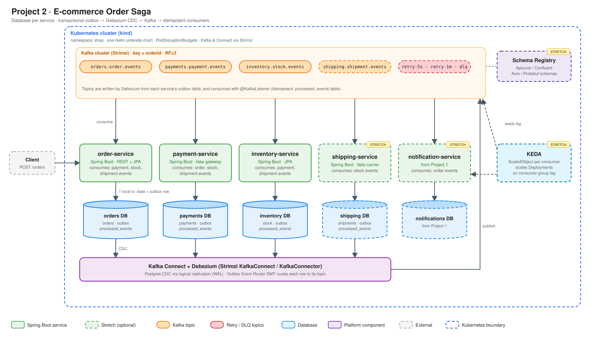
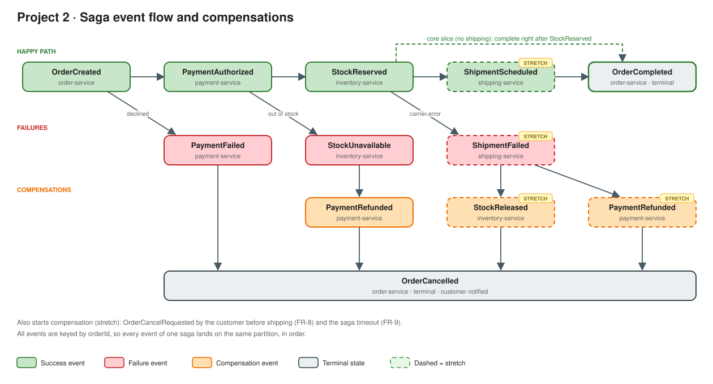

# Project 2 · Order Saga

> **Every step has an undo.**

**Level:** Upper-intermediate · **Core effort:** about a week · **Reuses:** Project 1

## What you build

An order moves through **order → payment → inventory → shipping**. There's no shared database and no distributed transaction, only events. If a step fails, the earlier steps are undone with **compensating events**.

**You learn:** sagas, the transactional outbox, Debezium CDC, Schema Registry and retry topics on Kafka, plus Helm, KEDA, PDBs and graceful shutdown on Kubernetes.

## Event-driven architecture

**Style:** choreographed saga + transactional outbox

```
save + outbox  →  Debezium  →  Kafka  →  next service reacts  →  save + outbox …
```

- **Nobody calls anybody.** Each service reacts to an event and emits the next one.
- **Failure is just another event.** `StockUnavailable` → `PaymentRefunded` → `OrderCancelled`.
- **The outbox keeps the database and Kafka in sync.** Data and event are saved in one DB transaction, and Debezium ships the event.

> 🧠 **Remember:** *Outbox in. Idempotent out. Compensate on failure.*
> Save and publish together · process each event once · undo with events, not rollbacks.

## Architecture



| Service | Owns | Job |
|---------|------|-----|
| `order-service` | orders DB | API, order status, timeout |
| `payment-service` | payments DB | Charge and refund (fake gateway) |
| `inventory-service` | inventory DB | Reserve and release stock |
| `shipping-service` | shipping DB | Book shipment (fake carrier) |
| `notification-service` | (Project 1) | Tell the customer |

## Saga flow



**Order status:** `PENDING → PAYMENT_AUTHORIZED → STOCK_RESERVED → SHIPPING_SCHEDULED → COMPLETED`, or `… → COMPENSATING → CANCELLED`.

**Topics:** one per service (`orders.order.events`, `payments.payment.events`, `inventory.stock.events`, `shipping.shipment.events`), all keyed by `orderId`.

## Scope

- **Core:** order, payment and inventory with outbox + Debezium. Happy path, plus two failures: payment declined, and out of stock → refund. One Helm chart. Pass AT-1 to AT-3.
- **Stretch:** shipping, customer cancel, timeout, retry topics, Schema Registry, notifications, KEDA, PDBs.

## Spring Boot building blocks

| Need | Use |
|------|-----|
| Outbox | One `@Transactional` method saves the entity **and** an `OutboxEvent` row |
| CDC | Strimzi `KafkaConnector` + Debezium `EventRouter` SMT (Postgres `wal_level=logical`) |
| Idempotent consumer | `@KafkaListener` + `@Transactional`: insert `processed_events(event_id)` and apply the change together |
| Retry topics | `@RetryableTopic` + `@DltHandler` |
| Schemas | `avro-maven-plugin` + Apicurio or Confluent serde |
| Timeout job | `@Scheduled` (+ ShedLock if there's more than one replica) |
| Autoscale | KEDA `ScaledObject` with a `kafka` trigger |
| Tracing | Micrometer Tracing + OpenTelemetry (`observationEnabled=true`) |

> ⚠️ **Gotchas**
> - **`@RetryableTopic` breaks per-key ordering.** A retried event can arrive after a newer one. Check the order's state in the handler, or use blocking retries.
> - **Outbox + Avro is awkward.** Start with JSON in the outbox.

## Functional requirements

| ID | Scope | Requirement |
|----|-------|-------------|
| **FR-1** | **Core** | **Place order:** `POST /orders` with an `Idempotency-Key` → `202` + `orderId`. |
| **FR-2** | **Core** | **Track order:** `GET /orders/{id}` shows status and event timeline. |
| **FR-3** | **Core** | **Pay:** a fake gateway authorizes. Declines and errors are configurable. |
| **FR-4** | **Core** | **Reserve stock:** all or nothing. Stock never goes negative. |
| **FR-5** | Stretch | **Ship:** a fake carrier books the shipment and can fail. |
| **FR-6** | **Core** | **Undo when out of stock:** refund → `CANCELLED`. |
| **FR-7** | Stretch | **Undo when shipping fails:** release stock + refund → `CANCELLED`. |
| **FR-8** | Stretch | **Customer cancel:** allowed before shipping; runs the needed undos. |
| **FR-9** | Stretch | **Timeout:** stuck for over 2 min → cancel + undo. |
| **FR-10** | **Core** | **Outbox:** state and event in one DB transaction, published by Debezium. No direct `KafkaTemplate`. |
| **FR-11** | Stretch | **Retry topics:** `retry-5s` → `retry-1m` → `dlq`. |
| **FR-12** | Stretch | **Schemas:** Avro or Protobuf in Schema Registry, `BACKWARD` compatible. |
| **FR-13** | Stretch | **Notify:** completed or cancelled → Project 1 sends a message. |
| **FR-14** | Stretch | **DLQ admin:** list, inspect, replay. |

## Non-functional requirements

| ID | Scope | Area | Requirement |
|----|-------|------|-------------|
| **NFR-1** | **Core** | Correctness | **Always finishes:** every order ends `COMPLETED` or `CANCELLED` within 5 min. |
| **NFR-2** | **Core** | Correctness | **Money and stock add up:** no charge on cancelled orders, stock ≥ 0, refunds ≤ charges (checked by a script). |
| **NFR-3** | **Core** | Correctness | **No dual writes:** the DB and Kafka can never disagree. |
| **NFR-4** | **Core** | Correctness | **Idempotent consumers:** a duplicate event changes nothing. |
| **NFR-5** | **Core** | Correctness | **Per-order sequence:** key = `orderId`. |
| **NFR-6** | Stretch | Performance | **200 orders/s** sustained. |
| **NFR-7** | Stretch | Performance | **p95 < 3 s** from order to final state. |
| **NFR-8** | Stretch | Scale | **KEDA:** scale on consumer lag, from 1 up to the partition count. |
| **NFR-9** | Stretch | Availability | **PDBs:** a node drain never takes a service fully down. |
| **NFR-10** | Stretch | Ops | **Graceful stop:** finish, commit and close in under 30 s. |
| **NFR-11** | **Core** | Ops | **Helm:** one umbrella chart, dev/prod values, zero-downtime upgrade. |
| **NFR-12** | Stretch | Ops | **Infra as CRs:** topics, Connect and connectors as Strimzi resources. |
| **NFR-13** | Stretch | Ops | **Safe schema changes:** adding an optional field breaks no consumer. |
| **NFR-14** | **Core** | Design | **DB per service:** no service reads another's DB. |
| **NFR-15** | Stretch | Observability | **Trace by `orderId`** in logs and Kafka headers. |
| **NFR-16** | Stretch | Observability | **Saga metrics:** duration, cancels by reason, lag, DLQ depth. |
| **NFR-17** | Stretch | Security | **Own credentials:** each service only has its own DB secret. |

## Acceptance tests

| # | Scope | Do this | Pass when | Proves |
|---|-------|---------|-----------|--------|
| AT-1 | **Core** | Kill `payment-service` with 100 orders in flight | All orders finish and the invariants pass | NFR-1, NFR-2, NFR-4 |
| AT-2 | **Core** | Send 1,000 orders: 10% out of stock, 5% declined | Counts are correct and every cancel is refunded | FR-6, NFR-2 |
| AT-3 | **Core** | Pause Debezium for 2 min | Nothing is lost after resume | FR-10, NFR-3 |
| AT-4 | Stretch | Burst 2,000 orders in 10 s | KEDA scales up, lag drains, then it scales down | NFR-8 |
| AT-5 | Stretch | Register a breaking schema | The registry rejects it | FR-12 |
| AT-6 | Stretch | Add an optional `giftMessage` field | Old consumers still work | NFR-13 |
| AT-7 | Stretch | Drain a node | Services stay up, no order gets stuck | NFR-9 |
| AT-8 | Stretch | Inject 30% inventory errors | Retry tiers work, and the rest go to the DLQ | FR-11 |
| AT-9 | Stretch | Cancel an order at `STOCK_RESERVED` | Stock released, payment refunded, order `CANCELLED` | FR-8 |

## Out of scope

Orchestrated sagas (e.g. Temporal) · real payments and carriers · auth · multi-currency.
