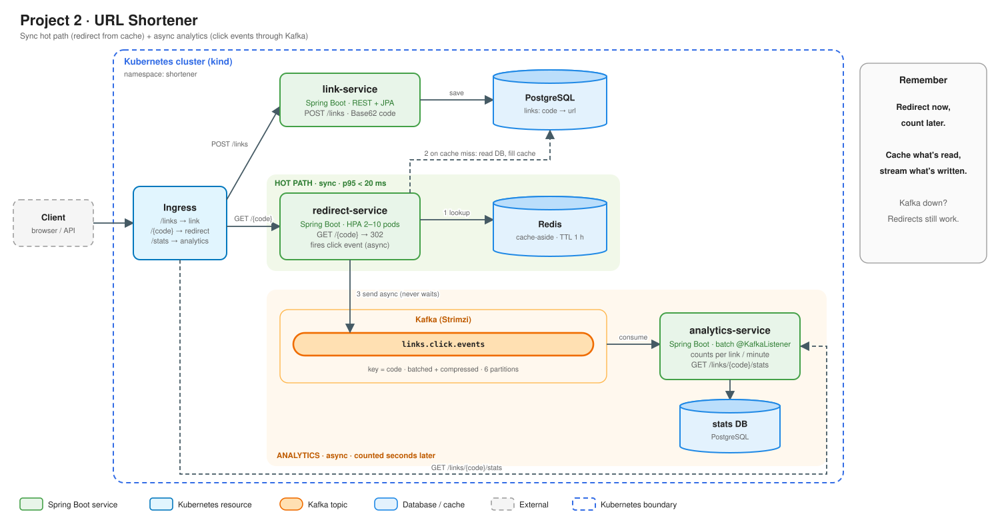
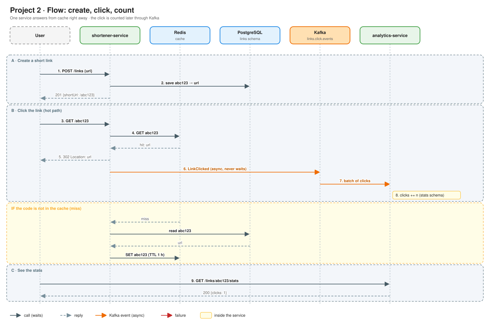

# Project 2 · URL Shortener

> **Redirect now, count later.**

**Level:** Intermediate · **Core effort:** a weekend · **Bridge:** from sync (Project 1) to async (Project 3)

## What you build

Users create short links (`/abc123`). Opening one **redirects instantly** from a Redis cache. Every click becomes a **Kafka event**, and an analytics service counts clicks per link in the background.

**You learn:** caching (cache-aside, TTL, cache stampede), read-heavy performance, high-volume Kafka producers and batch consumers, plus Ingress, HPA and Redis on Kubernetes.

## Architecture style

**Style:** hybrid. A **sync hot path** for redirects and an **async event path** for analytics.

```
GET /abc123  →  redirect-service  →  Redis  →  302           (sync, fast)
                      └→  LinkClicked  →  Kafka  →  analytics  (async, later)
```

- **The hot path is tiny.** A redirect never waits for analytics or a DB write.
- **Cache first.** Redis answers most redirects, and Postgres is only the backup.
- **Clicks are events.** There are lots of them, they're cheap to send, and they're counted in batches.

> 🧠 **Remember:** *Redirect now, count later.*
> And: **cache what's read, stream what's written.**

## Architecture



| Service | Job |
|---------|-----|
| `link-service` | `POST /links` → generate a code → save to Postgres |
| `redirect-service` | `GET /{code}` → Redis (or Postgres on a miss) → `302` + async click event. **Scales on its own (HPA).** |
| `analytics-service` | Consume clicks → count per link and per minute → `GET /links/{code}/stats` |

| Topic | Key | Holds |
|-------|-----|-------|
| `links.click.events` | `code` | One `LinkClicked` per redirect: code, time, country, device, referrer |

## How it works

### User stories

**User side**

| As a… | I want to… | So that… |
|-------|------------|----------|
| User | shorten a long URL | I can share a short link |
| Visitor | open a short link | I land on the page instantly |
| Link owner | see how many people clicked | I know if my link works |
| Link owner | set an expiry or disable a link *(stretch)* | old links stop working |

**Service side**

| Service | Its story |
|---------|-----------|
| `link-service` | I create a unique code and save it. I never reuse a code. |
| `redirect-service` | I answer from Redis, fall back to Postgres on a miss, and fire a click event **without waiting**. |
| `analytics-service` | I read clicks in batches and add them to the counts. A few seconds late is fine. |

### Flow: create, click, count



**A · Create**
1. The user sends `POST /links {url}`.
2. `link-service` saves `abc123 → url` and returns the short URL.

**B · Click (hot path)**

3. A visitor opens `/abc123`.
4. `redirect-service` looks it up in Redis (a hit).
5. The visitor gets `302` straight away.
6. `redirect-service` fires `LinkClicked` to Kafka without waiting.
7. `analytics-service` reads a batch of clicks.
8. It adds them to the counts.

**C · Stats**

9. The owner calls `GET /links/abc123/stats` and sees the clicks.

**On a cache miss:** read Postgres, put the URL in Redis (TTL 1 h), then redirect.

## Scope

- **Core:** create, redirect with a Redis cache, click events → total counts, HPA on `redirect-service`. Pass AT-1 to AT-4.
- **Stretch:** custom aliases, expiry, per-country/device stats, time windows, live dashboard, stampede protection, exact counts.

## Spring Boot building blocks

| Need | Use |
|------|-----|
| Redirect | `ResponseEntity.status(FOUND).location(uri).build()` |
| Cache | Spring Data Redis (`RedisTemplate`) or `@Cacheable` with a TTL |
| Short code | Base62 of a DB sequence (or 7 random chars + unique constraint) |
| Send clicks | `KafkaTemplate.send()` **without** `.get()`; `linger.ms=20`, `compression.type=lz4` |
| Count clicks | Batch `@KafkaListener` + JDBC batch upsert (`ON CONFLICT … DO UPDATE SET clicks = clicks + ?`) |
| Time windows | Kafka Streams `windowedBy(TimeWindows.ofSizeWithNoGrace(Duration.ofMinutes(1)))` |
| Live dashboard | Server-Sent Events (`SseEmitter`) or WebSocket |
| Rate limiting | Bucket4j + Redis on `POST /links` |
| Autoscale | Kubernetes HPA (CPU) for `redirect-service`; KEDA (lag) for analytics |
| Load test | k6 |
| Tests | Testcontainers: Redis, Kafka, PostgreSQL |

> ⚠️ **Gotchas**
> - **Hot keys.** One viral link means one key, so one partition does all the work. Pre-aggregate in the producer, or spread the load and re-key later.
> - **Double counting.** After a consumer crash, the same batch can be counted twice. For exact counts, store the offsets in the same DB transaction as the counts.

## Functional requirements

| ID | Scope | Requirement |
|----|-------|-------------|
| **FR-1** | **Core** | **Shorten:** `POST /links {url}` → `{code, shortUrl}`. Invalid URLs are rejected. |
| **FR-2** | **Core** | **Redirect:** `GET /{code}` → `302` to the long URL. Unknown code → `404`. |
| **FR-3** | **Core** | **Unique codes:** 7-char Base62, never reused. |
| **FR-4** | Stretch | **Custom alias:** `POST /links {url, alias}`; `409` if the alias is taken. |
| **FR-5** | Stretch | **Expiry:** links can expire. Expired → `410 Gone`. |
| **FR-6** | **Core** | **Click event:** every redirect publishes `LinkClicked`. |
| **FR-7** | **Core** | **Click count:** `GET /links/{code}/stats` → total clicks. |
| **FR-8** | Stretch | **Breakdown:** clicks per country, device and referrer. |
| **FR-9** | Stretch | **Time series:** clicks per minute for the last hour. |
| **FR-10** | Stretch | **Live dashboard:** top 10 links, updated every 2 s. |
| **FR-11** | Stretch | **Disable link:** stops working at once (cache evicted). |

## Non-functional requirements

| ID | Scope | Area | Requirement |
|----|-------|------|-------------|
| **NFR-1** | **Core** | Performance | **Fast redirect:** p95 < 20 ms on a cache hit. |
| **NFR-2** | **Core** | Performance | **Never wait for Kafka:** send asynchronously. Kafka down → redirects still work. |
| **NFR-3** | **Core** | Performance | **Cache first:** ≥ 95% cache hit rate under load (cache-aside, TTL 1 h). |
| **NFR-4** | Stretch | Performance | **2,000 redirects/s** sustained on kind. |
| **NFR-5** | Stretch | Performance | **Stampede-safe:** 1,000 concurrent requests for a cold link → only 1 DB query. |
| **NFR-6** | **Core** | Scale | **Scale reads separately:** `redirect-service` has its own HPA (CPU 70%, 2–10 pods). |
| **NFR-7** | Stretch | Scale | **Analytics scales on lag** (KEDA). |
| **NFR-8** | **Core** | Reliability | **Clicks are cheap but kept:** batching and compression, `acks=all`. No loss while Kafka is up. |
| **NFR-9** | Stretch | Correctness | **Exact counts:** offsets saved with the counts, so a crash never double-counts. |
| **NFR-10** | **Core** | Correctness | **Eventually right:** stats trail real clicks by less than 5 s. |
| **NFR-11** | Stretch | Correctness | **No hot partition:** a viral link doesn't overload one consumer. |
| **NFR-12** | **Core** | Ops | **Probes + graceful stop** (Actuator) on every service. |
| **NFR-13** | **Core** | Ops | **Config outside the image:** ConfigMaps and Secrets. |
| **NFR-14** | Stretch | Security | **Abuse protection:** rate-limit link creation and block known-bad domains. |
| **NFR-15** | Stretch | Observability | **Metrics:** redirect latency, cache hit rate, click lag. |

## Acceptance tests

| # | Scope | Do this | Pass when | Proves |
|---|-------|---------|-----------|--------|
| AT-1 | **Core** | Create a link and open it | `302` to the right URL, and stats show 1 click within 5 s | FR-1, FR-2, FR-6, NFR-10 |
| AT-2 | **Core** | k6: 1,000 redirects of one link | p95 < 20 ms, hit rate ≥ 95%, stats = 1,000 | NFR-1, NFR-3 |
| AT-3 | **Core** | 🔌 Make Kafka unreachable, then redirect | Redirects still work at normal speed | NFR-2 |
| AT-4 | **Core** | Ramp the load up, then down | HPA adds `redirect-service` pods, then removes them | NFR-6 |
| AT-5 | Stretch | Kill analytics in the middle of a batch | Counts are still exact | NFR-9 |
| AT-6 | Stretch | 1,000 concurrent hits on a cold link | Only 1 DB query | NFR-5 |
| AT-7 | Stretch | One link gets 90% of all traffic | No single consumer falls far behind | NFR-11 |
| AT-8 | Stretch | Open an expired link | `410 Gone` | FR-5 |
| AT-9 | Stretch | Disable a link, then open it | `404` immediately | FR-11 |

## Testing

| Type | File | What it proves |
|------|------|----------------|
| End-to-end | [testing/e2e/02-url-shortener.md](../testing/e2e/02-url-shortener.md) | The user stories work across all services |
| Load (k6) | [testing/load/02-url-shortener.js](../testing/load/02-url-shortener.js) | The performance NFRs (`k6 run -e PROFILE=load …`) |

## Out of scope

Custom domains · user accounts and auth · QR codes · UI (Postman or curl is fine).

## Next

Here Kafka was a side path. In **Project 3**, Kafka becomes the main way services talk to each other.
