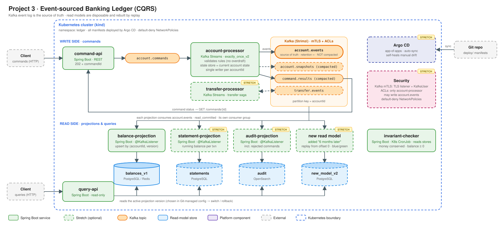

# Project 3 · Banking Ledger

> **The log is the truth. Everything else is a view.**

**Level:** Advanced · **Core effort:** 1–2 weeks · **Builds on:** Projects 1 and 2

## What you build

A bank ledger where every change is an **immutable event** in Kafka. Balances, statements and the audit trail are **read models** built from those events. Any read model can be rebuilt at any time by replaying from offset 0.

**You learn:** event sourcing, CQRS, replay, exactly-once and schema evolution on Kafka, plus GitOps (Argo CD), blue/green, NetworkPolicies, mTLS and ACLs on Kubernetes.

## Event-driven architecture

**Style:** event sourcing + CQRS

```
command  →  validate  →  EVENT LOG (forever)  →  projections  →  queries
```

- **Events are the database.** Current state = replay all events.
- **Write and read are separate apps.** They are joined only by the event log.
- **Read models are disposable.** Need a new one? Replay. Broke one? Delete it and rebuild.

> 🧠 **Remember:** *Commands ask. Events are facts. Projections answer.*
> And: **never edit an event. Add a new one.**

**Two design rules:**
1. **One writer per account.** Key = `accountId`, so one processor handles each account in sequence, and two withdrawals can't spend the same money.
2. **Never compact the event log.** Compaction deletes history. Compact only "latest state" topics (snapshots, command results).

## Architecture



| Service | Job |
|---------|-----|
| `command-api` | `POST` commands → `account.commands`; `GET /commands/{id}` for status |
| `account-processor` | **Only writer** of `account.events`. Validates (no overdraft) and emits events. |
| `transfer-processor` | Transfer saga: debit → credit → complete (or reverse) |
| `*-projection` | Build balances, statements and audit from `account.events` |
| `query-api` | Read-only API over the projections |
| `invariant-checker` | CronJob that checks money is conserved |

| Topic | Policy | Holds |
|-------|--------|-------|
| `account.commands` | delete, 7 days | Incoming commands |
| `account.events` | **delete, retention ∞** | **Source of truth** |
| `account.snapshots` | compact | Latest state per account |
| `command.results` | compact | `ACCEPTED` or `REJECTED` per command |
| `transfer.events` | delete, ∞ | Transfer saga steps |

## Scope

- **Core:** open, deposit and withdraw · one writer per account · infinite event log · **one** balance projection · rebuild from offset 0. Pass AT-2 and AT-4.
- **Stretch:** transfers, statements, audit, snapshots, upcasting, Argo CD, blue/green, mTLS and ACLs. **AT-1 is the capstone challenge, so do it last.**

## Spring Boot building blocks

| Need | Use |
|------|-----|
| Validate + write events | `@EnableKafkaStreams` + Processor API + `KeyValueStore<accountId, AccountState>` |
| Exactly-once | `processing.guarantee=exactly_once_v2` (one line, so turn it on early) |
| Fast restart | Kafka Streams restores the state store from its changelog |
| Projections | `@KafkaListener` + `isolation.level=read_committed` + upsert `WHERE version < :new` |
| Rebuild | New `group.id` (`balance-projection-v2`) + new table (`balances_v2`, Flyway) |
| Switch version | `@ConfigurationProperties` from a Git-managed ConfigMap |
| Upcasting | An `EventUpcaster` that converts v1 → v2 before handling |
| Kafka mTLS | `security.protocol=SSL` + Strimzi `KafkaUser` Secret (keystore) + cluster CA (truststore) |
| Invariant job | Spring Boot (no web) as a Kubernetes `CronJob` |
| Tests | `TopologyTestDriver` (fast) + Testcontainers (replay) |

## Functional requirements

| ID | Scope | Requirement |
|----|-------|-------------|
| **FR-1** | **Core** | **Open account** → `AccountOpened`. |
| **FR-2** | **Core** | **Deposit** → `MoneyDeposited`. |
| **FR-3** | **Core** | **Withdraw** → `MoneyWithdrawn`. Rejected if funds are too low or the account is frozen. |
| **FR-4** | Stretch | **Transfer:** debit → credit → complete. Reverse if the credit fails. |
| **FR-5** | Stretch | **Freeze / close:** frozen means no debits. Close only at balance 0. |
| **FR-6** | **Core** | **Async commands:** `202` + `commandId`; `GET /commands/{id}` → `ACCEPTED` or `REJECTED`. `Idempotency-Key` required. |
| **FR-7** | Stretch | **Record rejections:** a `CommandRejected` event, for the audit trail. |
| **FR-8** | Stretch | **Snapshots:** every 100 events per account. |
| **FR-9** | **Core** | **Balance:** `GET /accounts/{id}/balance`, including its version. |
| **FR-10** | Stretch | **Statement:** paginated, with a running balance. |
| **FR-11** | Stretch | **Audit:** full history, including rejections. |
| **FR-12** | Stretch | **Balance as of:** the balance at any past timestamp. |
| **FR-13** | Stretch | **Read your writes:** `?minVersion=` waits up to 2 s. |
| **FR-14** | **Core** | **Rebuild:** replay from offset 0 into a new versioned store while the old one keeps serving. |
| **FR-15** | Stretch | **New read model later:** backfill from full history, then go live. |
| **FR-16** | Stretch | **Switch and roll back:** pick the projection version in Git config. |
| **FR-17** | Stretch | **Versioned events:** `MoneyDeposited` v2 adds `channel`. |
| **FR-18** | Stretch | **Upcast:** read v1 as v2 in memory. Never rewrite stored events. |

## Non-functional requirements

| ID | Scope | Area | Requirement |
|----|-------|------|-------------|
| **NFR-1** | **Core** | Correctness | **Money is conserved:** balances ≥ 0, and sum of balances = deposits − withdrawals. |
| **NFR-2** | Stretch | Correctness | **Exactly-once writes:** Kafka transactions (`exactly_once_v2`). |
| **NFR-3** | Stretch | Correctness | **Exactly-once reads:** `read_committed` + upsert by version. |
| **NFR-4** | **Core** | Correctness | **One writer per account:** key = `accountId`. |
| **NFR-5** | Stretch | Correctness | **Fresh reads:** projection lag p95 < 1 s. |
| **NFR-6** | **Core** | Durability | **Never lose an event:** RF=3, `min.insync.replicas=2`, `acks=all`, retention ∞. |
| **NFR-7** | **Core** | Durability | **Never edit an event:** fix mistakes with a new event. |
| **NFR-8** | **Core** | Durability | **Projections are disposable:** lose the DB, rebuild it from the log. |
| **NFR-9** | Stretch | Performance | **Rebuild 1M events in under 10 min.** |
| **NFR-10** | Stretch | Performance | **1,000 commands/s** sustained. |
| **NFR-11** | Stretch | Performance | **p95 < 500 ms** from command to result. |
| **NFR-12** | Stretch | Performance | **Restart < 60 s,** including state restore. |
| **NFR-13** | Stretch | Deploy | **GitOps only:** Argo CD, app-of-apps, self-heal. |
| **NFR-14** | Stretch | Deploy | **Blue/green projections:** switch when lag ≈ 0 and checksums match. |
| **NFR-15** | Stretch | Deploy | **Zero downtime:** 0 failed queries during a deploy or switch. |
| **NFR-16** | Stretch | Security | **Default-deny network** with NetworkPolicies. |
| **NFR-17** | Stretch | Security | **mTLS to Kafka:** Strimzi TLS listener + `KafkaUser`. |
| **NFR-18** | Stretch | Security | **Least-privilege ACLs:** only `account-processor` writes `account.events`. |
| **NFR-19** | Stretch | Security | **Service-to-service mTLS** (optional, e.g. Linkerd). |
| **NFR-20** | Stretch | Observability | **Metrics:** lag, rebuild %, reject rate, invariant result. |
| **NFR-21** | Stretch | Observability | **Alerts:** invariant broken, lag > 5 s, crash loop. |
| **NFR-22** | Stretch | Observability | **Traceable:** every event links to its `commandId` and `correlationId`. |

## Acceptance tests

| # | Scope | Do this | Pass when | Proves |
|---|-------|---------|-----------|--------|
| AT-1 | Stretch | 🏆 **"Six months later":** load 1M old events, add a read model through a Git PR, backfill and switch while under load | The new model is correct, with 0 failed requests | FR-15, FR-16, NFR-15 |
| AT-2 | **Core** | Drop the balance DB and rebuild | Same checksum as before | FR-14, NFR-8 |
| AT-3 | Stretch | Kill `account-processor` during 500 transfers | No money is created or lost | NFR-1, NFR-2 |
| AT-4 | **Core** | 50 parallel withdrawals of 10 from a balance of 100 | Exactly 10 succeed, and the balance never goes below 0 | FR-3, NFR-4 |
| AT-5 | Stretch | Roll out `MoneyDeposited` v2 | Old events show `channel = UNKNOWN` | FR-17, FR-18 |
| AT-6 | Stretch | Have a projection try to write to `account.events` | The ACL denies it | NFR-18 |
| AT-7 | Stretch | Connect to Kafka from a pod in another namespace | NetworkPolicy blocks it | NFR-16 |
| AT-8 | Stretch | `kubectl edit` a Deployment by hand | Argo CD reverts it | NFR-13 |
| AT-9 | Stretch | Ask for the balance as of 3 months ago | It matches a manual replay | FR-12 |

## Out of scope / stretch ideas

**Out:** real money · KYC/compliance · multi-currency · UI.
**Ideas:** crypto-shredding for GDPR · MirrorMaker 2 disaster recovery · interest accrual as a CronJob · your own `Projection` operator (CRD).
